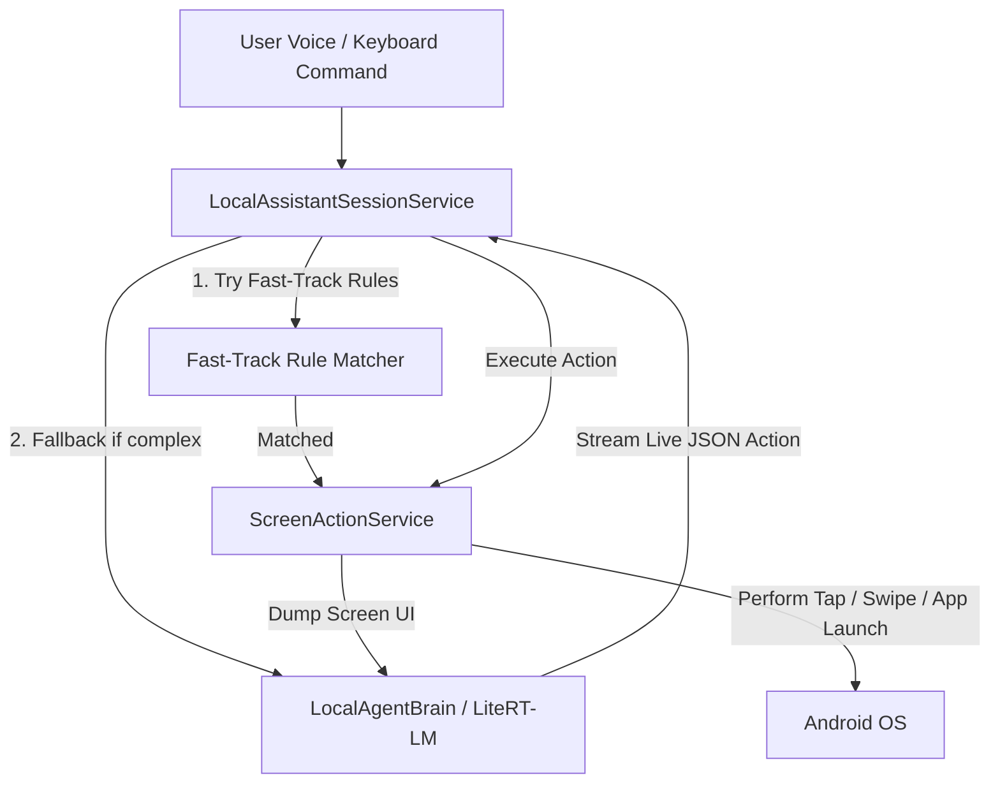

# Andrea 🤖📱

**Andrea** is an on-device AI voice assistant for Android. It combines local LLM/SLM inference via **LiteRT-LM** with Android **VoiceInteractionService** and **AccessibilityService** to give your device an autonomous AI agent capable of seeing your screen and taking actions—all locally on GPU without sending data to the cloud.

---

## ✨ Features

- **🔒 100% On-Device & Private**: Uses LiteRT-LM (MediaPipe LLM Inference) running locally on GPU (`.litertlm` model files). No cloud APIs or data transmission required.
- **🎙️ System Assistant Overlay**: Serves as a system-level Default Digital Assistant (`VoiceInteractionService`). Long-press home or swipe up to summon a floating, Google Assistant-style bottom control bar.
- **⚡ Fast-Track Action Engine**: Instant (<10ms) rule-based execution for standard commands like Google Voice Access:
  - `open <app name>` (e.g., `"open YouTube"`, `"launch Settings"`)
  - `tap <label or ID>` / `click <label or ID>` (e.g., `"tap Search"`, `"click 3"`)
  - `type <text>` (e.g., `"type hello world"`)
  - `scroll down` / `scroll up`
  - `swipe left` / `swipe right` / `swipe up` / `swipe down`
  - `home` / `back` / `recents` / `notifications`
- **🧠 SLM Screen Reasoning Fallback**: For complex goals, the local LLM parses the screen UI tree (`AccessibilityNodeInfo`) and generates JSON actions (`click`, `type`, `open_app`, `scroll_down`, `scroll_up`, `home`, `back`, `done`).
- **💬 Real-Time Streaming Output & Interactive Controls**:
  - Live token-by-token streaming of SLM responses.
  - Interactive status bar with Microphone button (🎙), Keyboard toggle (⌨), Text input box, Send (➔), and Dismiss (✕).
- **🎨 Jetpack Compose UI**: Clean setup dashboard to import `.litertlm` models, set default assistant, and grant accessibility permissions.

---

## 🏗️ Architecture

---

## 📋 Requirements & Setup

### Prerequisites
- **Android Device**: Android 10 (API level 29) or higher.
- **LiteRT-LM Model File**: A compatible `.litertlm` model file (e.g., Gemma 2B GPU, Phi-3, or Llama 3 8B quantized for LiteRT).

### Initial App Setup
1. **Import Model**: Open the app, click **"Select .litertlm Model from Downloads"**, and choose your imported model file.
2. **Set Default Voice Assistant**: Click **"Set as Default Assistant"** and select **Andrea** under *Digital assistant app*.
3. **Enable Accessibility Service**: Click **"Enable Accessibility Service"** and enable **Andrea Accessibility Service** under *Installed Services*.

---

## 🛠️ Project Tech Stack

- **Language**: Kotlin 2.4.21
- **UI Framework**: Jetpack Compose with Material 3
- **On-Device AI**: `com.google.ai.edge.litertlm:litertlm-android`
- **Build System**: Android Gradle Plugin 9.4.1 (Gradle 9.0)
- **Min SDK**: 29 (Android 10)
- **Target/Compile SDK**: 37 (Android 15)

---

## 📄 License

Distributed under the MIT License. See `LICENSE` for details.
